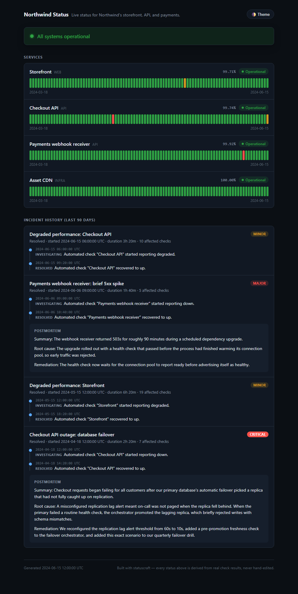
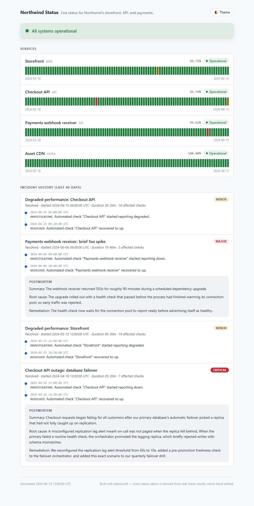
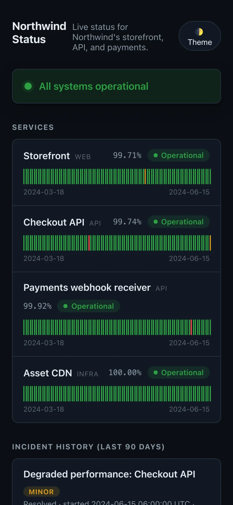

# statuscraft

**A static status page generator that refuses to lie.**

[Case study ↗](https://hellpuff.dev/work/statuscraft)

Every status you see on a statuscraft page (the green banner, the amber
"degraded" badge, the incident timeline) is computed from rows in an
append-only result log at the moment the page is generated. There is no
admin panel with a dropdown that lets you type "Operational" over an outage.
If you want the page to say something, a synthetic check has to actually
observe it.

<p align="center">
  
  
</p>

<p align="center">
  
</p>

These are real screenshots of the output of `npm run demo:build`, a seeded,
deterministic fixture checked into [`examples/demo/`](examples/demo) (full
page in dark and light, and the same page at phone width). Open
`examples/demo/site/index.html` in a browser to click through it yourself, or
run `npm run demo:build && npm run build && node dist/cli.js serve -d
examples/demo/site`.

## Status

Version 1.0.0, a working single-user tool. It runs HTTP checks only, from one
machine, and writes a static site; there is no hosted service, no alerting and
no npm release. CI runs on Ubuntu, Windows and macOS with Node 20.

## Why this exists

Most "status page" tools are one of two things: a hosted SaaS where an
engineer clicks a big green button to declare "all systems operational" (and
sometimes forgets, or fudges it, during an actual incident), or a static
template where the HTML is hand-edited on deploy. Neither one is checking
anything. statuscraft is built the other way around:

1. A **checker** actually calls your endpoints on a schedule and evaluates
   assertions against the real response: status code, latency, body
   content, JSON fields, headers.
2. Every observation, pass or fail, is **appended, never edited**, to a
   plain JSONL file. That file _is_ the audit trail: `git diff` it, ship it
   to cold storage, replay it through the generator again. Given the same
   generation time, the output is byte-identical (that is how
   `npm run demo:build` stays reproducible); the CLI uses the current time,
   which moves the "Generated" stamp and the staleness cut-off.
3. **Incidents are derived, not declared.** A run of consecutive
   degraded/down observations for a check _is_ an incident. You can attach a
   postmortem and a nicer title afterward, but you cannot invent one that the
   checks didn't produce.
4. The **generator** is a pure function from `(config, all results, incident
overlay, generation time)` to the page. Nothing about "current status" is stored anywhere
   except as a consequence of the check history.

## What's here

| Piece           | Where            | What it does                                                                                            |
| --------------- | ---------------- | ------------------------------------------------------------------------------------------------------- |
| Checker         | `src/checker/`   | Runs HTTP checks with a timeout, evaluates assertions, and derives `up` / `degraded` / `down`           |
| Result store    | `src/store/`     | Append-only JSONL log + day-bucketed uptime aggregation                                                 |
| Incident engine | `src/incidents/` | Detects incidents from consecutive bad runs; merges an optional human-authored postmortem overlay       |
| Generator       | `src/generator/` | Writes `index.html`, `assets/style.css`, `assets/theme.js` and a `data.json` snapshot; dark/light aware |
| CLI             | `src/cli.ts`     | `init`, `check`, `generate`, `serve`, `status`                                                          |

## Quickstart

Requires Node.js 20 or newer and npm. `check` needs outbound network access to
the URLs you configure.

```bash
npm install
npm run build                              # compiles the CLI to dist/
node dist/cli.js init                      # writes statuscraft.config.json
node dist/cli.js check --once              # runs every configured check once
node dist/cli.js generate                  # builds dist-site/index.html
node dist/cli.js serve                     # preview it at http://127.0.0.1:4321
```

statuscraft is not published to npm, and the `statuscraft` name on the npm
registry belongs to an unrelated project. Run the CLI from this checkout
(`node dist/cli.js`, or `npm run dev -- <command>` to run from source), not
with `npx statuscraft` elsewhere. `serve` binds to `127.0.0.1` only.

The sample config from `init` points at `example.com`, so its checks really
go over the network; `/api/health` there returns 404, so expect that check
to be reported `down`. A run on a fresh directory looks like this (latencies
and timestamps will differ):

```text
$ node dist/cli.js init
Wrote /path/to/statuscraft.config.json
Next: statuscraft check --once, then statuscraft generate
$ node dist/cli.js check --once
[2026-10-26T06:56:37.322Z] ran 2 check(s)
  UP       Marketing site (399ms)
  DOWN     Public API (371ms)
$ node dist/cli.js generate
Generated /path/to/dist-site/index.html
Overall status: down
Services: 2, incidents: 1, results read: 2
$ node dist/cli.js status
down
$ node dist/cli.js serve
Serving /path/to/dist-site at http://127.0.0.1:4321
```

The `Next:` hint printed by `init` uses the `statuscraft` bin name; from a
checkout, run it as `node dist/cli.js` instead.

Run checks on a loop instead of once, then regenerate on a cron:

```bash
node dist/cli.js check                     # runs forever on `intervalMinutes`
# ...separately, whenever you want to publish...
node dist/cli.js generate
```

### CLI reference

| Command    | Options (defaults)                                                                                                                       |
| ---------- | ---------------------------------------------------------------------------------------------------------------------------------------- |
| `init`     | `-f, --force` overwrite an existing `statuscraft.config.json`                                                                            |
| `check`    | `-c, --config` (`statuscraft.config.json`), `-o, --out` result log (`data/results.jsonl`), `--once` run one round and exit               |
| `generate` | `-c, --config`, `-r, --results` (`data/results.jsonl`), `-i, --incidents` overlay (`data/incidents.json`), `-d, --out-dir` (`dist-site`) |
| `serve`    | `-d, --dir` (`dist-site`), `-p, --port` (`4321`); always binds `127.0.0.1`                                                               |
| `status`   | `-c, --config`, `-r, --results`; prints `up`, `degraded`, `down` or `unknown` and exits                                                  |

`node dist/cli.js --help` and `node dist/cli.js <command> --help` print the
same list.

### Configuring checks

`statuscraft.config.json`:

```json
{
  "site": { "name": "Acme", "description": "Live status for Acme's public APIs." },
  "intervalMinutes": 5,
  "uptimeWindowDays": 90,
  "staleAfterMinutes": 15,
  "checks": [
    {
      "id": "public-api",
      "name": "Public API",
      "group": "API",
      "url": "https://example.com/api/health",
      "assertions": [
        { "kind": "status", "expected": 200 },
        { "kind": "maxLatencyMs", "degradedAboveMs": 400, "downAboveMs": 3000 },
        { "kind": "bodyContains", "value": "ok" }
      ]
    }
  ]
}
```

Assertion kinds: `status` (exact code or `[min, max]` range), `maxLatencyMs`
(separate degraded/down thresholds; this is the _only_ thing that can
produce `degraded`, every other assertion is pass/fail), `bodyContains`,
`bodyNotContains`, `bodyMatches` (`pattern`, optional `flags`), `jsonPath`
(`path` + `equals`, dot-path equality against a parsed JSON body), and
`headerEquals` (`header` + `value`).

Each check also accepts `method` (`GET`, `HEAD` or `POST`), `headers`, a
request `body` and `timeoutMs` (default 10000). Check ids must be lowercase
kebab-case and unique, because incident ids and history are keyed on them.
`site` accepts `name`, `description`, `url`, `logoText` and `supportUrl`.
The config is validated with zod (`src/config/schema.ts`); `check`,
`generate` and `status` exit with a list of problems on an invalid file.

**Missing and stale data are never green.** A service with no results is
shown as "No data yet", and a service whose newest result is older than
`staleAfterMinutes` (default: three check intervals, i.e. 15 minutes with
the default `intervalMinutes: 5`) is shown as "No recent data"; its last
observed status is history, not the current state. The page banner only
says "All systems operational" when every service has a fresh `up`
result. Rows in the result log that are not valid observations (unknown
status, unparseable timestamp, missing check id) are skipped and counted in
a warning by `generate`/`status`, and rows dated more than five minutes in
the future are never used as the current status.

**How degraded differs from down:** a non-latency assertion failing (wrong
status code, missing text, a network error) is always `down`. Latency past
`degradedAboveMs` but under `downAboveMs`, with everything else passing, is
`degraded`. This is the one rule the whole "not just up/down" story rests on;
see `src/checker/statusEngine.ts`.

### Writing a postmortem

Incidents need no configuration; they fall out of the check history
automatically. Any run of consecutive non-`up` results for one check is an
incident: `minor` if it only reached `degraded`, `major` if it went `down`,
`critical` if it went `down` and lasted three or more results. To add a title
and postmortem, look up the incident's `id` in `dist-site/data.json` (the
`generate` output only prints a count) and add it to `data/incidents.json`:

```json
{
  "incidents": [
    {
      "id": "public-api-2024-04-18T12:00:00.000Z",
      "title": "Checkout API outage: database failover",
      "severity": "critical",
      "postmortem": "Summary: ...\n\nRoot cause: ...\n\nRemediation: ..."
    }
  ]
}
```

An entry can also override `severity` and replace the automatic `updates`
timeline (`timestamp`, `state`, `message`). The `id` has to match a real
detected incident or the entry is silently ignored, and an overlay file that
is not valid JSON is ignored as a whole; see `src/incidents/overlay.ts`.

## Architecture

```
statuscraft.config.json ──┐
                           ▼
                    ┌──────────────┐        data/results.jsonl
  every N minutes → │   checker    │ ───append-only───▶ (the audit trail)
                    └──────────────┘                          │
                                                                │ read in full
data/incidents.json ───────────────────────────────┐           ▼
   (optional, human)                                ▼   ┌──────────────┐
                                              ┌─────────▶│ buildSiteData│
                                              │          │  (pure fn)   │
                                              │          └──────┬───────┘
                                    incident overlay             │
                                       merge only,                ▼
                                     never invents          GeneratedSiteData
                                                                   │
                                                                   ▼
                                                          ┌────────────────┐
                                                          │  renderPage +  │
                                                          │  writeSite     │
                                                          └───────┬────────┘
                                                                  ▼
                                                     dist-site/index.html
                                                     dist-site/assets/*.css,*.js
                                                     dist-site/data.json (audit snapshot)
```

`buildSiteData` (`src/generator/buildSiteData.ts`) is the one function you
need to understand: `({ config, results, overlay, now? }) ->
GeneratedSiteData`, where `now` defaults to the current time. With `now`
fixed it is pure and synchronous, which is what makes the
generator's output reproducible and easy to unit test: every test in
`test/buildSiteData.test.ts` and `test/renderPage.test.ts` calls it directly
with hand-built result arrays instead of running real HTTP checks.

## Development

```bash
npm ci
npm test           # vitest, 145 tests in 15 files
npm run coverage   # about 98.6% statement coverage
npm run lint       # eslint --max-warnings=0
npm run format     # prettier --check .
npm run typecheck  # tsc --noEmit, strict
npm run build      # emit dist/
npm run demo:build # regenerate examples/demo/ from a seeded fixture
```

`npm run demo:build` is deterministic: rerunning it on a clean checkout leaves
`git status` clean.

CI (`.github/workflows/ci.yml`) runs typecheck, lint, tests with coverage,
build, and a full demo-site build on Ubuntu, Windows, and macOS (Node 20),
plus a Prettier check on Ubuntu.

`test/honesty.test.ts` is the "refuses to lie" regression suite: missing,
stale, future-dated and malformed data must never produce a green page, and
values from the result log or the incident overlay must never inject markup.

## Limitations

- HTTP(S) checks only: no TCP, DNS, ICMP or TLS-expiry checks.
- One checker process writing one local JSONL file. There is no multi-region
  probing, so an outage of the machine running `check` shows up as stale data,
  not as a confirmed outage.
- No notifications or alerting; publishing the page (cron + `generate` + your
  web server or static host) is up to you.
- `serve` is a preview server only. See [SECURITY.md](SECURITY.md).
- The result log is read in full on every `generate`; it is never compacted.

[docs/PRODUCTION_READINESS.md](docs/PRODUCTION_READINESS.md) records what was
tested for the 1.0.0 release and what was not.

## Contributing

See [CONTRIBUTING.md](CONTRIBUTING.md). Security issues go through the private
advisory form described in [SECURITY.md](SECURITY.md).

## License

MIT, copyright 2026 Prabesh Sharma. See [LICENSE](LICENSE).
